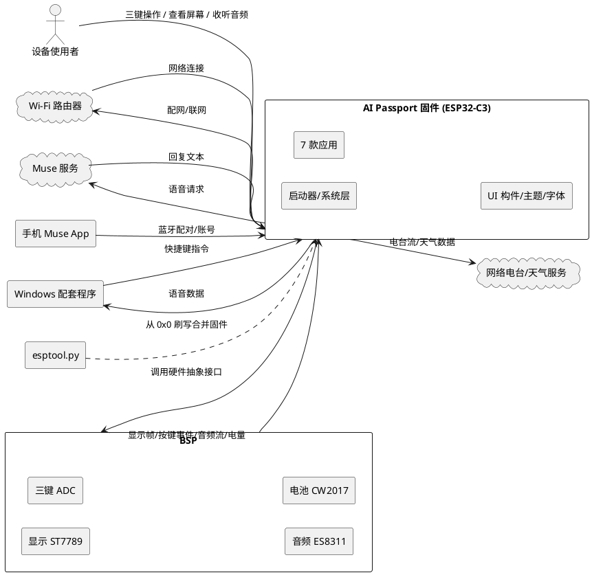
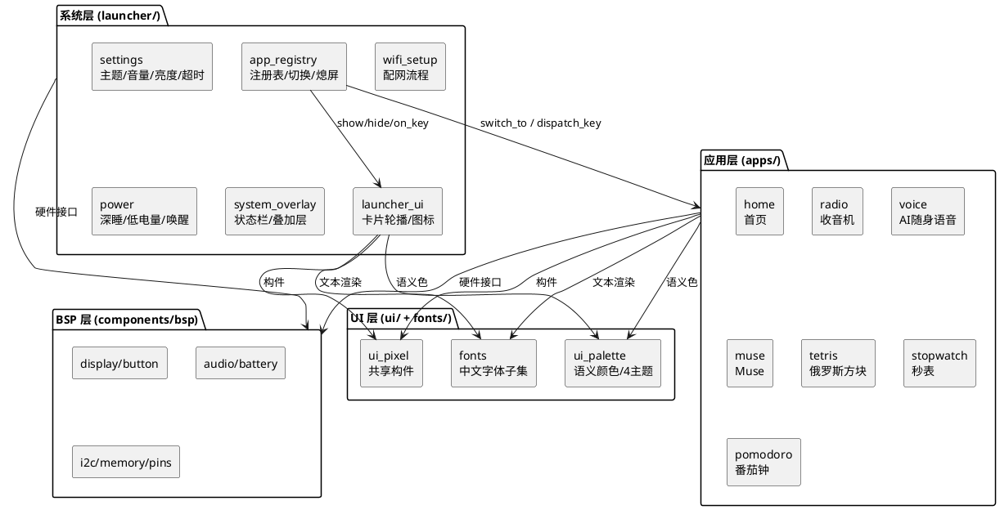
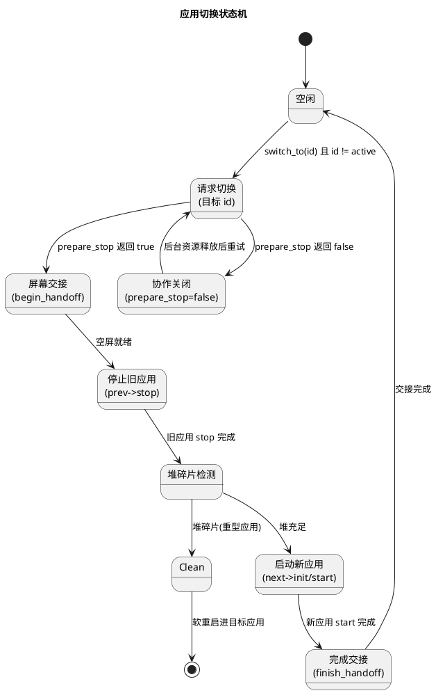
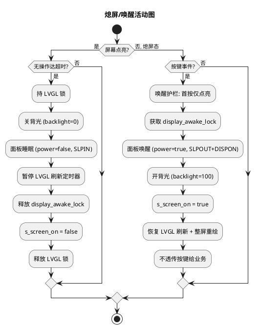
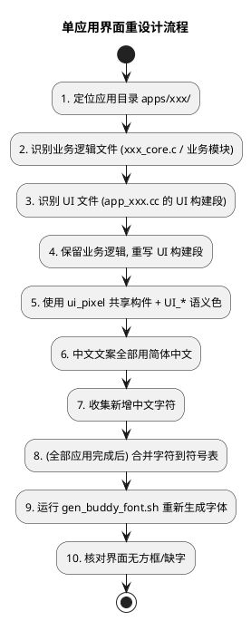
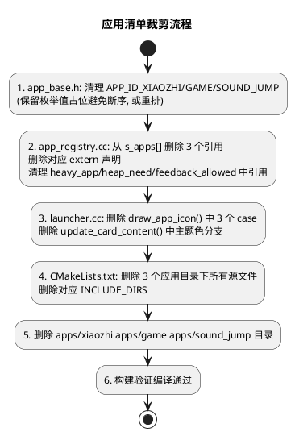
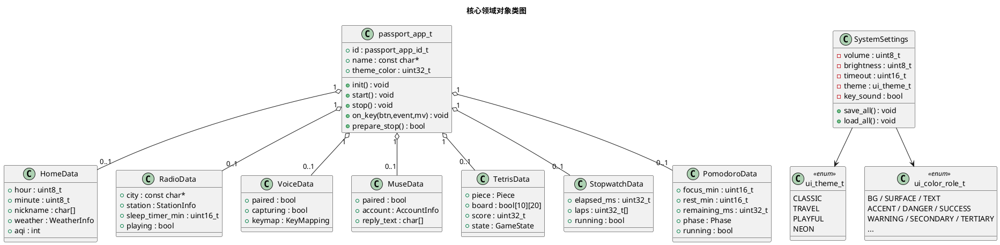

# AI Passport 应用固件实现方案

> 平台：ESP32-C3 · 8MB Flash · ESP-IDF 5.5.3 + LVGL · ST7789 240×320 · 三键（UP/DOWN/OK）
> 复用：passport-os BSP，重新设计界面，不照搬 demo
> 交付：可从 0x0 刷写的合并固件
> 配套需求：`.codeartsdoer/specs/ai_passport_apps/spec.md`

---

# 一、需求与存量功能关系分析

## 1.1 需求功能与存量功能对比

存量代码位于 `passport-os/passport-os-main/`，已实现 12 款应用（含启动器、设置、Wi-Fi 配网等系统应用）与完整的系统层功能。本需求固定应用清单为 7 款，并要求所有应用界面重新设计、不照搬 demo。因此存量代码与需求的关系是：**业务逻辑高度复用，视觉实现需整体重做，应用清单需裁剪**。

### 1.1.1 已实现功能

下列功能在存量代码中已完整实现，需求可直接复用，无需改动逻辑。

| 需求功能 | 存量功能 | 代码位置 | 匹配度 |
|---------|---------|---------|--------|
| 应用注册与切换（7 款应用浏览切换） | 启动器维护注册表 `s_apps[]`，`switch_to()` 串行化切换 | `main/launcher/app_registry.cc:50-61`、`app_registry.cc:331-428` | 100% |
| 应用生命周期契约（init/start/stop/on_key/prepare_stop） | `passport_app_t` 结构体定义全部钩子 | `main/apps/app_base.h:37-57` | 100% |
| 预置 4 个主题 | `ui_theme_t` 枚举 4 主题 + 语义角色色表 + 持久化 | `main/ui/ui_palette.h:10-16`、`launcher/settings.cc:70-80` | 100% |
| 音量调节（静音至最大，持久化） | 设置页音量行 + `bsp_audio_set_master_volume` + NVS 持久化 | `main/launcher/settings.cc:36`、`components/bsp/include/bsp_audio.h:48-49` | 100% |
| 亮度调节（最低至最高，持久化） | 设置页亮度行 + `bsp_display_set_master_brightness` + NVS | `main/launcher/settings.cc:32`、`components/bsp/include/bsp_display.h:34-35` | 100% |
| 自动熄屏（无操作达时长熄屏） | `app_registry_tick()` 周期检测超时，关背光+面板睡眠+暂停 LVGL | `main/launcher/app_registry.cc:537-572` | 100% |
| 短按唤醒（熄屏态短按任一键唤醒） | `dispatch_key()` 熄屏唤醒护栏，首按仅点亮不透传 | `main/launcher/app_registry.cc:447-468` | 100% |
| Wi-Fi 配网（输入 SSID/密码，持久化自动连接） | `wifi_setup` 应用 + `wifi_picker` 键盘选择 + `esp-wifi-connect` 组件 | `main/launcher/wifi_setup.cc`、`wifi_picker.cc` | 100% |
| 电池显示（电量与充电状态实时） | `bsp_battery_soc()` + 状态栏 `ui_pixel_battery` 构件 + 系统监控周期轮询 | `components/bsp/include/bsp_battery.h:18-20`、`main/ui/ui_pixel.h:64-72` | 100% |
| 功耗管理（按应用组合省电策略） | `power_save_level_for()` 按应用选 Wi-Fi 省电档 + `power.cc` 深睡 + `esp_pm` 锁 | `main/launcher/app_registry.cc:95-105`、`main/launcher/power.cc` | 100% |
| 语义颜色（禁止硬编码色值） | `ui_color_role_t` 13 个角色 + `UI_*` 宏 + 4 主题色表 | `main/ui/ui_palette.h:18-75` | 100% |
| 合并固件构建（从 0x0 刷写单一 bin） | `build.sh release` 产出 `FoloToy-AI-Passport-full.bin` | `build.sh`、`partitions.csv` | 100% |
| 字体生成机制（新增中文字符可补字形） | `gen_buddy_font.sh` 调 `lv_font_conv` 从思源黑体子集化 | `main/fonts/gen_buddy_font.sh` | 100% |
| 配置持久性（重启后保留） | NVS 命名空间 `system_prefs` 存音量/亮度/超时/主题 | `main/launcher/settings.cc:70-80` | 100% |
| 应用崩溃隔离（单应用异常不致死机） | `switch_to()` 互斥 + `prepare_stop` 协作关闭 + 重型应用干净启动 | `main/launcher/app_registry.cc:78-159` | 100% |

### 1.1.2 需要扩展的功能

下列功能在存量代码中已有实现，但需求要求**重新设计界面、不照搬 demo**，故需在保留业务逻辑的前提下重做视觉层；同时应用清单需裁剪。

| 需求功能 | 存量功能 | 差异说明 | 扩展方向 |
|---------|---------|---------|---------|
| 首页界面（时钟+名片+天气空气质量） | `app_home.cc` + `home_clock/home_profile/home_weather` | 存量界面为 demo 风格；需求要求重新设计视觉布局，与 demo 区分 | 重写 `app_home.cc` 的 UI 构建部分，复用 `home_clock/home_weather` 数据逻辑，改用新布局构件组合；天气离线提示保留 |
| 收音机界面（城市/电台/播放/睡眠计时） | `app_radio.cc` + `radio_ui/radio_player/radio_catalog/radio_sleep_timer` | 存量 `radio_ui.cc` 为 demo 视觉；需求要求重设计 | 重写 `radio_ui.cc` 视觉层，复用 `radio_player/radio_catalog/radio_sleep_timer` 业务逻辑；城市/电台列表交互重排 |
| AI 随身语音界面（采集状态/配对/快捷键联动） | `app_voice.cc` + `app_ui/app_protocol/audio_streamer/udp_audio` | 存量 `app_ui.c` 为 demo 视觉；需求要求重设计 | 重写 `app_ui.c` 视觉层，复用 `app_protocol/audio_streamer/udp_audio` 通信逻辑；采集状态指示重新设计 |
| Muse 界面（配对/语音发送/回复阅读） | `app_muse.cc` + `passport_muse` 组件 | 存量界面为 demo 视觉；需求要求重设计 | 重写 `app_muse.cc` 的 UI 部分，复用 `passport_muse` 组件通信；回复文本展示重新设计 |
| 俄罗斯方块界面（堆叠/消行/计分/局结束） | `app_tetris.cc` + `tetris_core.c` | 存量界面为 demo 视觉；需求要求重设计 | 重写 `app_tetris.cc` 的渲染部分，复用 `tetris_core.c` 游戏逻辑（下落/消行/判定）；画面风格重设计 |
| 秒表界面（计时/分段/暂停继续/重置） | `app_stopwatch.cc` + `stopwatch_core.c` | 存量界面为 demo 视觉；需求要求重设计 | 重写 `app_stopwatch.cc` 的 UI 部分，复用 `stopwatch_core.c` 计时逻辑；数字显示与分段列表重设计 |
| 番茄钟界面（专注/休息/到时提醒/暂停继续） | `app_pomodoro.cc` + `pomodoro_core.c` | 存量界面为 demo 视觉；需求要求重设计 | 重写 `app_pomodoro.cc` 的 UI 部分，复用 `pomodoro_core.c` 状态机；专注/休息状态视觉重设计 |
| 应用清单裁剪（移除小智 AI/你在狗叫什么/声音跳一跳） | `s_apps[]` 含 9 款轮播应用 + `xiaozhi/game/sound_jump` 目录 | 需求固定 7 款，需移除 3 款 | 从 `s_apps[]` 删除 3 个引用；从 `app_base.h` 枚举清理（或保留枚举值避免断序）；从 `CMakeLists.txt` 删除对应源文件；删除 3 个应用目录 |
| 启动器图标重设计（7 款应用图标） | `draw_app_icon()` 像素方块绘制各应用图标 | 需求要求界面重设计，图标需与新视觉风格一致 | 重写 `launcher.cc:140-269` 的 `draw_app_icon()` 各 case，移除 3 款已删应用的 case |
| 中文字体字符集扩展 | `buddy_font_16`（4360 字子集）+ `gen_buddy_font.sh` | 新界面文案可能引入存量字符集外的中文字符 | 收集全部新界面中文文案 → 合并到 `buddy_16_symbols.txt` → 运行 `gen_buddy_font.sh` 重新生成 → 核对无方框 |

### 1.1.3 需要新增的功能或接口

本需求未引入任何存量代码中完全不存在的业务功能。所有 7 款应用的核心业务逻辑、5 项系统层功能、构建交付链路在存量中均已实现。增量工作集中在**视觉资产重做**与**应用清单裁剪**，不新增接口契约。

唯一需要新增的"资产"是各应用重设计后的界面实现代码，它们仍遵循存量 `passport_app_t` 接口契约，属于既有接口的新实例，而非新接口。

## 1.2 存量功能详细分析

### 1.2.1 应用接口契约（`passport_app_t`）

- **接口契约**：每个应用以 `const passport_app_t` 全局实例暴露，字段含 `id`（枚举）、`name`（中文名）、`en_name`、`desc`、`tag`（网络特性标签）、`theme_color`（主题色 RGB888）、5 个生命周期钩子（`init/start/stop/on_key/prepare_stop`）。
- **业务规则**：`init` 仅首次进入调用一次（`s_initialized` 守卫）；`start` 每次进入前台调用；`stop` 退出前台清理资源；`on_key` 接收按键事件分发；`prepare_stop` 返回 `false` 表示仍有占用网络/音频资源，启动器延迟切换。
- **扩展点**：新增应用只需定义一个 `const passport_app_t g_xxx_app` 实例并加入 `s_apps[]`，无需修改接口本身。
- **约束**：`on_key` 运行于按键任务栈，不得阻塞；`stop` 必须释放堆内存与网络/音频资源（C3 无 PSRAM，重型应用退出后堆碎片需干净启动机制处理）。

### 1.2.2 应用注册表与切换（`app_registry`）

- **接口契约**：`app_registry_init/get_count/get_by_index/get_by_id/switch_to/dispatch_key/tick` 等。`switch_to` 是核心，串行化执行"停旧 App → 清理 → 启新 App"。
- **业务规则**：切换用递归互斥量 `s_switch_mutex` 串行化（3s 超时，宁可丢切换不永久挂起）；切换前 `begin_screen_handoff()` 建空屏保留旧画面避免黑屏闪烁；重型应用（收音机/小智/Muse）进入前 `needs_clean_launch()` 检测堆碎片，必要时软重启获得干净堆；Wi-Fi 省电档按前台应用动态切换。
- **约束**：`switch_to` 可被按键任务、串口命令任务、Wi-Fi 连接任务三方并发调用，互斥量保证安全；`dispatch_key` 内置熄屏唤醒护栏（首按仅点亮）与长按 OK 全局返回拦截。

### 1.2.3 启动器 UI（`launcher`）

- **接口契约**：`launcher_ui_init/show/hide/on_key/update_status`。
- **业务规则**：轮播卡片展示 `s_apps[]` 中应用，`draw_app_icon()` 用像素方块（`set_part/set_frame`）绘制各应用图标，支持多色主题下用 `UI_SECONDARY/UI_TERTIARY` 区分图标细节色。
- **扩展点**：`draw_app_icon()` 的 `switch(id)` 每个应用一个 case，新增/移除应用需同步增删 case。
- **约束**：图标用几何方块绘制，不依赖图标字体；主题色通过 `ui_theme_is_multicolor()` 判断后选择语义角色。

### 1.2.4 UI 共享构件（`ui_pixel`）

- **接口契约**：`ui_pixel_screen_create/panel_create/label/label_ls/footer/title_plate/top_bar/battery_create/wifi_bars_create/mascot` 等。
- **业务规则**：构件统一使用语义颜色（`UI_TEXT/UI_ACCENT/UI_BG` 等），不硬编码色值；`label_set_text` 做未变更跳过避免无谓重绘；顶栏 26px，电池文字固定 x=160。
- **约束**：无装饰性背景动画与常驻定时器（省电）；构件不持有屏幕指针。

### 1.2.5 主题与语义颜色（`ui_palette`）

- **接口契约**：`ui_theme_set/get/color/color_on_dark/portrait_color/name`。
- **业务规则**：4 主题（CLASSIC/TRAVEL/PLAYFUL/NEON），13 个语义角色（BG/SURFACE/SURFACE_ALT/BORDER/TEXT/TEXT_DIM/ACCENT/DANGER/ON_ACCENT/SUCCESS/WARNING/SECONDARY/TERTIARY）；`UI_*` 宏展开为 `ui_theme_color(role)` 运行时求值，主题切换立即全局生效。
- **约束**：所有界面颜色必须经 `UI_*` 宏，禁止直接 `lv_color_hex(0xXXXXXX)`。

### 1.2.6 字体子系统（`fonts`）

- **接口契约**：`app_fonts.h` 声明 `buddy_font_16`（4360 字中文子集，16px/2bpp）、`ui_font_20`（标题 20px/4bpp）、`voice_font_20`、`home_font_12`、`pomodoro_font_20/digits_48`、`radio_font/radio_font_title`。
- **业务规则**：`gen_buddy_font.sh` 用 `lv_font_conv` 从思源黑体 OTF 按 `buddy_16_symbols.txt` + `buddy_16_name_symbols.txt` + `city_symbols.txt` 字符集子集化生成 `buddy_font_16.c`。
- **约束**：新增中文字符必须合并到符号表重新生成，否则显示方框；`buddy_font_16` 作为中文回退字体被首页/收音机/AI语音动态文本依赖。

### 1.2.7 BSP 接口（`components/bsp`）

- **display**：`bsp_display_init/panel/io/fill/backlight/set_master_brightness/power` + LVGL 接入 `bsp_lvgl_init/lock/unlock`。背光 LEDC PWM 0-100%，面板电源走 ST7789 SLPIN/SLPOUT 真睡眠。
- **button**：三键共用 ADC 分压，事件含 PRESS/RELEASE/CLICK/DOUBLE/LONG/LONG_UP；面板上电瞬态抑制避免 ADC 耦合假按键。
- **audio**：ES8311 codec，I2C 控制 + I2S 数据；`init_capture/playback/feedback` 三种模式；`set_volume/set_master_volume` 双层音量（App 音量 × 整机主音量）。
- **battery**：CW2017 电量计 I2C 0x63，`soc/mv/poll`，10s 周期刷新缓存。
- **约束**：全部硬件访问必须经 BSP，不得绕过；I2C 总线共享幂等初始化。

### 1.2.8 构建与交付（`build.sh`）

- **业务规则**：`bash build.sh release` 在 WSL 中执行 ESP-IDF 构建，产出 `build-public/FoloToy-AI-Passport-full.bin` 合并固件（bootloader+分区表+应用），可从 0x0 一次性刷写。
- **约束**：构建必须在 WSL（Windows 无工具链）；分区表 8MB（nvs/phy_init/factory/cardid/storage）。

---

# 二、增量设计方案

## 2.1 实现模型

### 2.1.1 上下文视图

本固件作为 ESP32-C3 上的单体嵌入式应用，与外部系统的交互关系如下。所有硬件访问经 BSP，网络经 Wi-Fi，固件产物经 esptool.py 刷写。



### 2.1.2 服务/组件总体架构

固件内部按"系统层 / 应用层 / UI 层 / BSP 层"四层划分。本增量方案不改变分层，仅替换应用层视觉实现并裁剪应用清单。



**模块职责与配置项**

| 模块 | 职责 | 关键配置项 |
|------|------|-----------|
| app_registry | 应用注册表、串行化切换、熄屏/唤醒、重型应用干净启动 | 熄屏超时 `s_screen_timeout_seconds`（默认 60s）、重型应用堆需求表 |
| launcher_ui | 卡片轮播、像素图标绘制、应用名/页码 | `s_apps[]` 数组（应用清单） |
| settings | 主题/音量/亮度/熄屏超时/按键音设置 + NVS 持久化 | 音量步进 10、亮度档位 {20,40,60,80,100}、超时档位 {0,15,30,60,120,300} |
| wifi_setup | Wi-Fi 配网流程（键盘输入/选择） | 复用 `esp-wifi-connect` 组件 |
| power | 深睡/低电量告警/UP 键唤醒 | 低电量阈值 10%、深睡唤醒键 UP |
| 7 款应用 | 各自业务逻辑 + 界面（本方案重做界面） | 各应用内部状态 |

### 2.1.3 实现设计文档

#### 应用切换与生命周期状态机

应用切换由 `app_registry_switch_to()` 驱动，核心是"停旧→清理→启新"的串行化序列，配合 `prepare_stop` 协作关闭与重型应用干净启动。



#### 熄屏与唤醒流程

熄屏由 `app_registry_tick()` 在系统心跳中检测无操作超时驱动；唤醒由 `dispatch_key()` 的护栏在熄屏态首按时触发。



#### 界面重设计流程（每款应用统一方法）

7 款应用界面重做遵循统一流程，确保业务逻辑复用、视觉层独立替换、语义颜色与字体覆盖不遗漏。



#### 应用清单裁剪流程

移除小智 AI / 你在狗叫什么 / 声音跳一跳 3 款应用，需同步修改 4 处。



## 2.2 接口设计

### 2.2.1 总体设计

本方案**不新增任何接口**，完全复用存量 `passport_app_t` 应用接口契约与 `app_registry_*` 注册表接口。增量工作是为既有接口提供新的视觉实现实例。

接口分类与稳定性：

| 接口分类 | 接口 | 稳定性 | 说明 |
|---------|------|--------|------|
| 应用生命周期契约 | `passport_app_t` | 稳定 | 7 款应用均实现此契约，本方案仅替换各实例的 UI 实现 |
| 注册表接口 | `app_registry_*` | 稳定 | 不修改，仅 `s_apps[]` 数组成员裁剪 |
| 启动器 UI 接口 | `launcher_ui_*` | 稳定 | 不修改接口，重写 `draw_app_icon()` 内部实现 |
| UI 构件接口 | `ui_pixel_*` | 稳定 | 不修改，应用重设计时复用 |
| 主题/颜色接口 | `ui_theme_*` / `UI_*` | 稳定 | 不修改，4 主题已满足需求 |
| BSP 接口 | `bsp_*` | 稳定 | 不修改，全部硬件访问经此 |
| 字体接口 | `buddy_font_16` 等 | 稳定 | 不修改声明，重新生成 `.c` 扩展字符集 |

**接口变更策略**：本方案为零接口变更。所有改动集中在现有接口的实现体内部（应用 UI 构建代码、图标绘制代码、注册表数组初始化、CMake 源文件列表、字体符号表）。

### 2.2.2 接口清单

#### 应用生命周期契约（`passport_app_t`）

**接口签名**（定义于 `main/apps/app_base.h`，不变）：

```c
typedef struct {
    passport_app_id_t id;
    const char *name;           // 中文显示名
    const char *en_name;
    const char *desc;
    const char *tag;            // 网络特性标签
    uint32_t theme_color;       // 主题色 RGB888
    void (*init)(void);
    void (*start)(void);
    void (*stop)(void);
    void (*on_key)(uint8_t btn, app_btn_event_t event, uint16_t mv);
    bool (*prepare_stop)(void);
} passport_app_t;
```

**7 款应用实例**（全局 `const passport_app_t` 实例，本方案重做其 UI 实现）：

| 应用 | 实例符号 | id | 网络特性 | 界面重设计要点 |
|------|---------|----|---------|--------------|
| 首页 | `g_home_app` | APP_ID_HOME | Wi-Fi(天气) | 时钟+名片+天气区域新布局，离线提示 |
| 收音机 | `g_radio_app` | APP_ID_RADIO | Wi-Fi | 城市/电台列表+播放控制+睡眠计时新布局 |
| AI 随身语音 | `g_voice_app` | APP_ID_VOICE | BLE/串口 | 配对状态+采集指示+快捷键映射新布局 |
| Muse | `g_muse_app` | APP_ID_MUSE | BLE+Wi-Fi | 配对+采集+回复文本阅读新布局 |
| 俄罗斯方块 | `g_tetris_app` | APP_ID_TETRIS | 离线 | 游戏区+分数+局结束新视觉风格 |
| 秒表 | `g_stopwatch_app` | APP_ID_STOPWATCH | 离线 | 大号计时数字+分段列表+控制提示新布局 |
| 番茄钟 | `g_pomodoro_app` | APP_ID_POMODORO | 离线 | 专注/休息状态+倒计时+到时提醒新视觉 |

**业务说明**：每个应用实例的 `init/start/stop/on_key/prepare_stop` 实现业务逻辑（复用存量），UI 构建代码段重写。

**前置条件**：应用经 `app_registry_switch_to(id)` 启动，不得绕过启动器直接调用 `start`。

**后置条件**：`stop` 必须释放堆内存、网络/音频资源，使堆恢复可重入状态。

#### 注册表接口（`app_registry_*`，不变）

| 接口 | 业务说明 |
|------|---------|
| `app_registry_init()` | 初始化互斥量、PM 锁、LVGL 事件回调 |
| `app_registry_get_count()` | 返回 `s_apps[]` 长度（裁剪后为 7 + 设置 = 8） |
| `app_registry_get_by_index/get_by_id` | 按索引/ID 取应用描述 |
| `app_registry_switch_to(id)` | 串行化切换前台应用 |
| `app_registry_dispatch_key(btn,event,mv)` | 全局按键分发（含熄屏唤醒护栏、长按 OK 返回） |
| `app_registry_tick()` | 系统心跳：熄屏超时检测、交接屏清理 |
| `app_registry_set/get_screen_timeout` | 熄屏超时读写 |
| `app_registry_keep_awake()` | 非按键驱动应用续期抑制熄屏 |

#### 系统层接口（不变）

| 接口 | 位置 | 业务说明 |
|------|------|---------|
| `ui_theme_set/get/color` | `ui_palette.h` | 4 主题切换，运行时全局生效 |
| `bsp_audio_set_master_volume` | `bsp_audio.h` | 整机主音量 0-100% |
| `bsp_display_set_master_brightness` | `bsp_display.h` | 整机亮度上限 0-100% |
| `bsp_display_backlight/power` | `bsp_display.h` | 背光/面板电源（熄屏用） |
| `bsp_battery_soc/mv/poll` | `bsp_battery.h` | 电量/电压/周期轮询 |
| `wifi_setup_*` | `wifi_setup.h` | Wi-Fi 配网流程 |
| `power_*` | `power.h` | 深睡/低电量/唤醒 |

## 2.3 数据模型

### 2.3.1 设计目标

- **支持的业务场景**：7 款应用的前台运行与切换、4 主题切换、音量/亮度/熄屏超时配置、Wi-Fi 凭据持久化、电池状态实时显示、低功耗管理。
- **性能/容量目标**：单应用运行期 RAM 不超 ESP32-C3 可用上限（无 PSRAM）；重型应用（收音机/Muse）进入前堆碎片检测与干净启动；按键响应 <200ms、应用切换 <1s、屏幕 ≥30fps。
- **与存量数据兼容策略**：NVS 配置命名空间 `system_prefs` 与字段名（volume/brightness/timeout/theme/key_sound）不变，重启后配置无缝保留；应用内部状态（如秒表计时、番茄钟时段）经 `timer_resume` 机制跨重启恢复。

### 2.3.2 模型实现

核心领域对象及其关系如下。本方案不新增领域对象，仅复用存量数据结构；图为完整视图以明确各应用数据边界。



**对象创建与销毁策略**

| 对象 | 创建时机 | 销毁时机 | 持久化 |
|------|---------|---------|--------|
| passport_app_t 实例 | 编译期静态常量 | 不销毁 | 否（代码段） |
| SystemSettings | 启动时从 NVS 加载 | 不销毁 | NVS `system_prefs` |
| HomeData | 进入首页 `start` | 退出首页 `stop` | 昵称经 NVS/home_profile |
| RadioData | 进入收音机 `start` | 退出 `stop`（释放解码缓冲） | 城市选择经 NVS |
| VoiceData | 进入 AI 语音 `start` | 退出 `stop` | 配对状态/键位经 NVS |
| MuseData | 进入 Muse `start` | 退出 `stop` | 账号经配对获得 |
| TetrisData | 开始局 | 局结束/退出 | 最高分经 NVS（可选） |
| StopwatchData | 进入秒表 `start` | 退出 `stop` | 计时状态经 `timer_resume` 跨重启恢复 |
| PomodoroData | 进入番茄钟 `start` | 退出 `stop` | 时段状态经 `timer_resume` 跨重启恢复 |

**持久化策略**：系统配置统一走 NVS 命名空间 `system_prefs`；Wi-Fi 凭据走 `esp-wifi-connect` 组件受保护存储；计时类应用（秒表/番茄钟/收音机睡眠计时）经 `timer_resume` 机制在软重启后恢复，避免干净启动丢失运行中状态。不涉及表结构设计（嵌入式 NVS 键值存储）。

---

## 3. 实现步骤总览

本方案的实施顺序（供 tasks.md 细化）：

1. **新建开发分支**：从 `main` 新建分支，保留已有修改。
2. **应用清单裁剪**：移除小智 AI / 你在狗叫什么 / 声音跳一跳 3 款应用（`app_base.h` 枚举、`app_registry.cc` 数组、`launcher.cc` 图标、`CMakeLists.txt` 源文件、删除目录）。
3. **7 款应用界面重设计**：逐款重写 UI 构建段，复用业务逻辑，使用 `ui_pixel` 构件 + `UI_*` 语义色，中文文案。
4. **启动器图标重设计**：重写 `draw_app_icon()` 7 个 case，与新视觉风格一致。
5. **中文字体覆盖核对**：收集全部新界面中文字符 → 合并符号表 → `gen_buddy_font.sh` 重新生成 → 核对无方框。
6. **WSL 构建验证**：`bash build.sh release` 产出合并固件，确认编译通过。
7. **刷写与测试**：`esptool.py` 从 0x0 刷写，运行验证 7 款应用与系统层功能，记录测试结果与未验证项。
8. **交付**：合并固件 `FoloToy-AI-Passport-full.bin` + 测试结果说明 + 未验证项说明。
