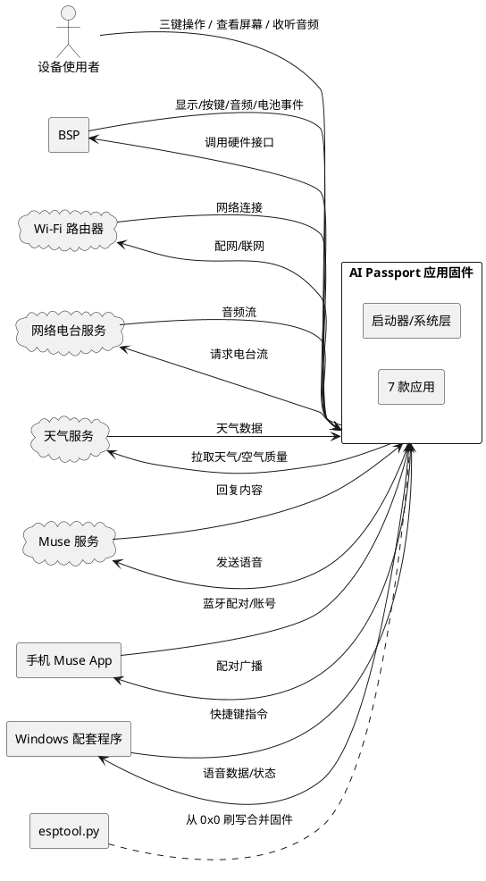
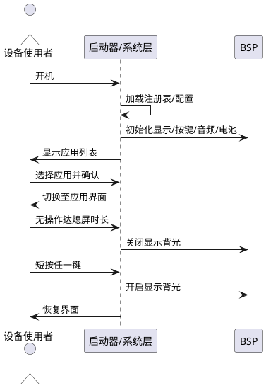
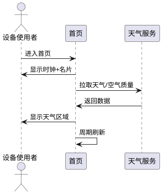
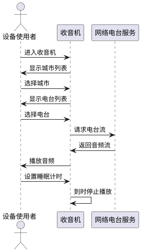
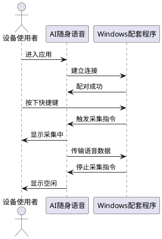
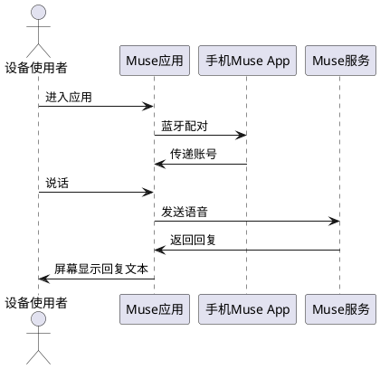
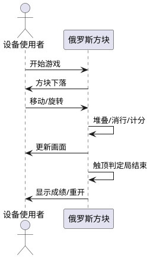
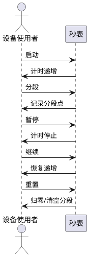
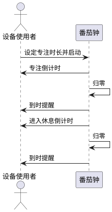

# AI Passport 应用固件需求规格

> 平台：ESP32-C3 · 8MB Flash · ESP-IDF 5.5.3 + LVGL · ST7789 240×320 · 三键（UP/DOWN/OK）
> 复用：passport-os BSP，重新设计界面，不照搬 demo
> 交付：可从 0x0 刷写的合并固件

---

# **1. 组件定位**

## **1.1 核心职责**
本组件负责 [管理并运行] [AI Passport 设备上的 7 款应用与系统层功能]，实现 [口袋式随身智能设备的完整交互体验]。

## **1.2 核心输入**
1. **三键操作指令**：来自设备使用者，通过 UP/DOWN/OK 三键产生的导航、确认、调节信号。
2. **Wi-Fi 配网信息**：来自使用者在配网流程中输入的 SSID 与密码。
3. **网络电台流**：来自公网网络电台服务，经 Wi-Fi 接收的音频流。
4. **天气与空气质量数据**：来自公网天气服务，经 Wi-Fi 拉取的实时数据。
5. **Muse 账号与语音回复**：来自手机 Muse App 配对后传递的账号信息与服务端回复。
6. **Windows 配套程序快捷键指令**：来自 PC 端配套程序，经蓝牙/串口联动的快捷键事件。
7. **电池状态信号**：来自 BSP 电池接口的电量、充电状态信号。
8. **定时触发信号**：来自系统定时的熄屏、睡眠计时、番茄钟到时信号。

## **1.3 核心输出**
1. **屏幕显示**：输出给使用者的 240×320 像素界面内容（应用界面、系统状态、提示信息）。
2. **音频输出**：输出给使用者的扬声器/耳机音频（电台、提示音、游戏音效）。
3. **Wi-Fi 连接状态**：输出给使用者的联网状态指示（已连接/断开/配网中）。
4. **配对广播**：输出给手机 Muse App 的蓝牙配对广播信号。
5. **快捷键联动响应**：输出给 Windows 配套程序的语音数据与状态回执。
6. **Muse 语音请求**：发送给 Muse 服务的语音消息。
7. **合并固件产物**：输出给刷写工具的单一 bin 文件（从 0x0 刷写）。

## **1.4 职责边界**
1. **不负责硬件驱动**：显示、按键、音频、电池、I2C、Flash 等硬件操作全部由 BSP 提供，本组件仅调用 BSP 接口。
2. **不负责固件烧写工具**：仅产出合并固件 bin，烧写由 esptool.py 等外部工具完成。
3. **不负责 Windows 配套程序实现**：仅定义与配套程序的联动协议与设备端响应，配套程序本身由独立项目开发。
4. **不负责 Muse 服务端实现**：仅作为 Muse 客户端，复用已有 passport_muse 组件。
5. **不负责天气/电台服务端实现**：仅作为消费方调用公网服务。
6. **不照搬 demo 界面**：所有应用界面需重新设计，与 passport-os demo 视觉区分。
7. **不新增"小智 AI""你在狗叫什么""声音跳一跳"3 款应用**：应用清单固定为 7 款。

---

# **2. 领域术语**

**应用（App）**
: 设备上可独立启动、运行、停止的功能单元，遵循统一应用接口契约。

**启动器（Launcher）**
: 管理应用注册表并提供应用切换入口的系统模块。

**主题（Theme）**
: 预置的界面色彩方案，包含文本、强调色、背景等语义角色的整体替换。
: 备注：本项目预置 4 个主题。

**语义颜色**
: 以用途命名的颜色角色（如文本色、强调色），而非具体色值，便于主题切换。

**省电堆**
: 低功耗管理策略集合，按应用需求组合的节能措施。

**网络电台**
: 通过 Wi-Fi 以流式方式播放的公共广播音频源。

**睡眠计时**
: 收音机中设定的定时关闭时长，到时自动停止播放。

**番茄钟**
: 以专注时段与休息时段交替循环进行时间管理的方法。

**名片**
: 首页中展示使用者个人资料、头像的卡片区域。

**配对**
: 设备与手机 Muse App 或 PC 配套程序建立通信连接的过程。

**熄屏**
: 在无操作一段时间后自动关闭屏幕显示以降低功耗的状态。

**唤醒**
: 在熄屏状态下通过短按任意键点亮屏幕恢复显示的操作。

**分段计时**
: 秒表中记录多个连续时间节点的功能，每个节点保存累计时长。

**消行**
: 俄罗斯方块中一行被填满后整行消除并计分的规则。

**合并固件**
: 将 bootloader、分区表、应用固件等合并为单一 bin 文件，可从地址 0x0 一次性刷写的产物。

---

# **3. 角色与边界**

## **3.1 核心角色**
- **设备使用者**：通过三键操作设备、查看屏幕、收听音频的唯一人类角色，负责配网、选择应用、使用各项功能。

## **3.2 外部系统**
- **BSP（板级支持包）**：提供显示、按键、音频、电池、I2C、Flash 等硬件抽象接口，本组件全部硬件操作经此进行。
- **Wi-Fi 路由器**：提供联网能力，用于网络电台、天气、Muse 等联网功能。
- **网络电台服务**：公网流媒体广播源，提供各城市可收听的电台流。
- **天气服务**：公网 API，提供实时天气与空气质量数据。
- **Muse 服务**：语音对话服务端，接收语音消息并返回回复。
- **手机 Muse App**：经蓝牙与设备配对，传递 Muse 账号并中继与服务端的通信。
- **Windows 配套程序**：经蓝牙/串口与设备联动，发送快捷键指令并接收设备语音输入。
- **esptool.py 刷写工具**：将合并固件从 0x0 写入设备 Flash 的外部工具。

## **3.3 交互上下文**

---

# **4. DFX约束**

## **4.1 性能**
1. **按键响应时间**：从按键事件到界面反馈必须不超过 200ms。
   - 验收条件：使用者按下任意键 → 界面在 200ms 内出现可见反馈。
2. **应用切换时间**：从确认切换到目标应用首帧渲染必须不超过 1s。
   - 验收条件：使用者在启动器选中应用并按 OK → 目标应用界面在 1s 内完成首帧显示。
3. **屏幕刷新率**：LVGL 渲染必须保持不低于 30fps。
   - 验收条件：任意应用运行期间 → 屏幕动画流畅无肉眼可见卡顿。
4. **网络电台起播延迟**：从选中电台到出声必须不超过 5s（Wi-Fi 已连接前提下）。
   - 验收条件：Wi-Fi 已连接且选中可用电台 → 5s 内开始播放音频。
5. **单实例资源占用**：应用运行期 RAM 占用必须不超过 ESP32-C3 可用上限（无 PSRAM）。
   - 验收条件：任意应用运行 → 不出现 OOM 崩溃或内存分配失败。

## **4.2 可靠性**
1. **Wi-Fi 断连重连**：Wi-Fi 异常断开后必须自动尝试重连，重连成功后联网应用恢复可用。
   - 验收条件：联网应用运行中 Wi-Fi 断开 → 自动重连且恢复后应用功能正常。
2. **应用崩溃隔离**：单个应用异常不得导致整机死机，必须能被启动器回收。
   - 验收条件：某应用运行中发生异常 → 启动器可将其停止并返回应用列表。
3. **固件可刷写性**：构建产物必须为可从 0x0 刷写的单一合并 bin。
   - 验收条件：执行构建命令 → 产出一个合并 bin，esptool.py 从 0x0 刷写后设备正常启动。
4. **配置持久性**：Wi-Fi 凭据、主题、音量、亮度等配置必须在重启后保留。
   - 验收条件：修改配置后重启设备 → 配置恢复为修改后的值。
5. **睡眠计时准确性**：收音机睡眠计时与番茄钟计时误差必须不超过 ±2s/小时。
   - 验收条件：设定 1 小时睡眠计时 → 实际关停时间与设定偏差不超过 2s。

## **4.3 安全性**
1. **Wi-Fi 凭据存储**：SSID 与密码必须存储于设备受保护分区，不得明文输出到日志。
   - 验收条件：配网后查看设备日志 → 不出现明文密码。
2. **Muse 账号保护**：Muse 账号凭据必须经配对授权后使用，不得在未配对状态下泄露。
   - 验收条件：设备未配对 → 不向外暴露 Muse 账号信息。

## **4.4 可维护性**
1. **日志规范**：关键操作（配网、应用启停、异常）必须输出结构化日志。
   - 验收条件：执行关键操作 → 串口日志含可识别的操作类型与结果。
2. **语义颜色**：所有界面颜色必须使用语义角色，禁止硬编码色值。
   - 验收条件：切换主题 → 全部界面色彩随之统一变化，无遗漏硬编码色。
3. **字体可扩展**：新增中文字符必须可通过字体生成脚本补充字形覆盖。
   - 验收条件：界面新增中文字符 → 经字体脚本生成后正常显示无方框。

## **4.5 兼容性**
1. **平台兼容**：固件必须适配 ESP32-C3 + 8MB Flash + ST7789 240×320 + 三键硬件。
   - 验收条件：在目标硬件刷写固件 → 设备正常启动且全部功能可用。
2. **中文显示**：全部界面文案必须使用简体中文且字形完整覆盖。
   - 验收条件：遍历全部界面 → 无缺字、无方框、无乱码。
3. **BSP 接口复用**：全部硬件访问必须经 BSP 接口，不得绕过直接操作硬件。
   - 验收条件：代码审查 → 不存在绕过 BSP 的直接硬件操作。

---

# **5. 核心能力**

## **5.1 系统层**

### **5.1.1 业务规则**
1. **应用注册与切换**：启动器必须维护 7 款应用的注册表，支持在应用列表中浏览与切换。
   - 验收条件：设备开机 → 启动器展示 7 款应用入口；选中并确认 → 切换至目标应用。
2. **主题预置**：系统必须预置 4 个主题，使用者可切换且立即生效并持久化。
   - 验收条件：进入主题设置 → 可见 4 个主题；选中其一 → 界面立即换色且重启后保持。
3. **音量调节**：系统必须提供音量调节，范围覆盖静音至最大音量，调节后持久化。
   - 验收条件：调节音量 → 扬声器音量随之变化且重启后保持。
4. **亮度调节**：系统必须提供屏幕亮度调节，范围覆盖最低至最高亮度，调节后持久化。
   - 验收条件：调节亮度 → 屏幕亮度随之变化且重启后保持。
5. **自动熄屏**：在无按键操作达到设定时长后必须自动熄屏以省电。
   - 验收条件：无操作达到熄屏时长 → 屏幕关闭；熄屏期间后台应用（如收音机）继续运行。
6. **短按唤醒**：熄屏状态下短按任意键必须唤醒屏幕恢复显示。
   - 验收条件：熄屏状态下短按任一键 → 屏幕点亮并恢复熄屏前界面。
7. **Wi-Fi 配网**：系统必须提供 Wi-Fi 配网流程，配网成功后持久保存凭据并自动连接。
   - 验收条件：执行配网输入有效 SSID/密码 → 连接成功且重启后自动连接。
8. **电池显示**：系统必须实时显示电池电量与充电状态。
   - 验收条件：电量变化或插入充电 → 状态栏电量指示随之更新。
9. **功耗管理**：系统必须按应用需求组合省电策略，熄屏与无后台任务时进入低功耗。
   - 验收条件：熄屏且无后台音频/联网任务 → 设备进入低功耗状态。
10. **禁止项**：禁止绕过启动器直接启动应用；禁止硬编码色值。
    - 验收条件：尝试绕过启动器 → 无此路径；界面出现色值 → 全部来自语义角色。

### **5.1.2 交互流程**

### **5.1.3 异常场景**
1. **Wi-Fi 配网失败**
   a. 触发条件：输入的 SSID 不存在或密码错误。
   b. 系统行为：提示连接失败并保留配网入口。
   c. 用户感知：屏幕显示"配网失败，请重试"。
2. **Wi-Fi 运行中断开**
   a. 触发条件：联网应用运行中路由器不可达。
   b. 系统行为：标记联网功能不可用并自动重连。
   c. 用户感知：状态栏显示未连接，联网应用提示"网络未连接"。
3. **电池低电量**
   a. 触发条件：电量低于阈值。
   b. 系统行为：低电量提示并限制高耗电操作。
   c. 用户感知：状态栏低电量警示。

## **5.2 首页**

### **5.2.1 业务规则**
1. **时钟显示**：首页必须显示实时时钟（时、分），并随时间自动刷新。
   - 验收条件：进入首页 → 显示当前时间；时间推进 → 显示随之更新。
2. **个人资料名片**：首页必须展示使用者头像与名片（昵称等个人资料）。
   - 验收条件：进入首页 → 可见头像与名片区域。
3. **天气与空气质量**：首页必须展示当前天气与空气质量；该区域在未联网时显示离线提示。
   - 验收条件：已联网 → 显示实时天气与空气质量；未联网 → 显示"网络未连接"提示。
4. **天气刷新**：天气数据必须周期性刷新，刷新失败时保留上次有效数据。
   - 验收条件：联网状态下到达刷新周期 → 更新数据；刷新失败 → 保留上次数据。
5. **禁止项**：禁止在未联网时阻塞首页其他区域。
   - 验收条件：未联网 → 时钟与名片仍正常显示。

### **5.2.2 交互流程**

### **5.2.3 异常场景**
1. **天气拉取失败**
   a. 触发条件：天气服务不可达或返回异常。
   b. 系统行为：保留上次有效数据，标注更新时间。
   c. 用户感知：天气区域显示上次数据或"暂无数据"。

## **5.3 收音机**

### **5.3.1 业务规则**
1. **城市选择**：收音机必须提供城市列表，使用者可选择目标城市。
   - 验收条件：进入收音机 → 可浏览并选择城市。
2. **电台选择**：选定城市后必须展示该城市可用电台列表，可选择电台播放。
   - 验收条件：选择城市 → 显示对应电台列表；选中电台 → 开始播放。
3. **播放与停止**：选中电台后开始流式播放，支持手动停止与恢复。
   - 验收条件：播放中按停止 → 停止播放；再按播放 → 恢复播放。
4. **睡眠计时**：必须支持设置睡眠计时，到时自动停止播放。
   - 验收条件：设置 N 分钟睡眠计时 → N 分钟后自动停止播放。
5. **联网前置**：未连接 Wi-Fi 时必须提示并阻止播放。
   - 验收条件：未联网选择电台 → 提示"请先连接 Wi-Fi"且不播放。
6. **禁止项**：禁止在未联网状态下尝试拉取电台流。
   - 验收条件：未联网 → 不发起网络请求。

### **5.3.2 交互流程**

### **5.3.3 异常场景**
1. **电台流不可用**
   a. 触发条件：选中电台但流地址不可达。
   b. 系统行为：停止播放并提示，可重试或换台。
   c. 用户感知：提示"电台不可用，请重试或选择其他电台"。
2. **Wi-Fi 中断**
   a. 触发条件：播放中 Wi-Fi 断开。
   b. 系统行为：停止播放并尝试重连。
   c. 用户感知：提示"网络中断"，重连后可手动恢复。

## **5.4 AI 随身语音**

### **5.4.1 业务规则**
1. **设备角色**：设备作为电脑的语音输入工具，采集使用者语音并传给 PC。
   - 验收条件：设备与 PC 联动 → 设备采集的语音传至 PC 作为输入。
2. **快捷键联动**：必须支持与 Windows 配套程序的快捷键联动，快捷键触发对应设备动作。
   - 验收条件：PC 按下联动快捷键 → 设备执行对应动作（开始/停止采集等）。
3. **配对前置**：使用前必须与 PC 配套程序完成配对/连接。
   - 验收条件：未配对 → 提示"请先与电脑配套程序配对"。
4. **状态指示**：设备必须显示当前是否处于语音采集状态。
   - 验收条件：采集开始 → 界面显示采集中；采集结束 → 界面显示空闲。
5. **禁止项**：禁止在未配对时向 PC 发送语音数据。
   - 验收条件：未配对 → 不发送任何语音数据。

### **5.4.2 交互流程**

### **5.4.3 异常场景**
1. **PC 未运行配套程序**
   a. 触发条件：设备尝试连接但 PC 端未启动。
   b. 系统行为：提示未连接并等待重试。
   c. 用户感知：提示"未找到电脑配套程序，请确认已启动"。
2. **连接中断**
   a. 触发条件：联动中连接断开。
   b. 系统行为：停止采集并提示。
   c. 用户感知：提示"连接已断开"。

## **5.5 Muse**

### **5.5.1 业务规则**
1. **手机配对**：使用前必须与手机 Muse App 完成蓝牙配对。
   - 验收条件：未配对 → 提示"请先用手机 Muse App 配对"。
2. **账号要求**：必须经配对获得有效 Muse 账号后方可使用。
   - 验收条件：无有效账号 → 提示"请先登录 Muse 账号"。
3. **语音发送**：使用者语音必须能发送给 Muse 服务。
   - 验收条件：采集中说话 → 语音发送至 Muse 服务。
4. **回复阅读**：Muse 回复必须在设备屏幕上以文本形式展示。
   - 验收条件：Muse 返回回复 → 屏幕显示回复文本。
5. **联网前置**：未联网时必须提示并阻止发送。
   - 验收条件：未联网尝试发送 → 提示"请先连接网络"。
6. **禁止项**：禁止在未配对或未联网时发送语音。
   - 验收条件：未配对或未联网 → 不发起发送。

### **5.5.2 交互流程**

### **5.5.3 异常场景**
1. **配对失败**
   a. 触发条件：手机 Muse App 未运行或蓝牙不可用。
   b. 系统行为：提示配对失败并保留重试入口。
   c. 用户感知：提示"配对失败，请重试"。
2. **Muse 服务无响应**
   a. 触发条件：发送语音后服务端超时无回复。
   b. 系统行为：提示超时可重试。
   c. 用户感知：提示"回复超时，请重试"。

## **5.6 俄罗斯方块**

### **5.6.1 业务规则**
1. **堆叠**：方块必须从顶部下落并堆叠于底部。
   - 验收条件：游戏运行 → 方块下落并停于堆叠区。
2. **消行**：一行被填满必须整行消除，上方方块下移并计分。
   - 验收条件：填满一行 → 该行消除、上方下移、分数增加。
3. **操作控制**：必须通过三键控制方块移动与旋转。
   - 验收条件：按对应键 → 方块按预期移动/旋转。
4. **局结束**：堆叠触顶必须判定局结束并显示成绩与重开入口。
   - 验收条件：方块堆至顶部 → 显示局结束与成绩，可重新开始。
5. **离线可用**：必须完全离线运行，不依赖任何网络。
   - 验收条件：无 Wi-Fi → 游戏全部功能正常。
6. **禁止项**：禁止联网获取任何资源。
   - 验收条件：游戏全程 → 无网络请求。

### **5.6.2 交互流程**

### **5.6.3 异常场景**
1. **局结束**
   a. 触发条件：方块堆叠至顶部。
   b. 系统行为：停止下落，显示成绩与重开入口。
   c. 用户感知：显示"游戏结束"与得分。

## **5.7 秒表**

### **5.7.1 业务规则**
1. **计时**：必须支持从零开始计时，精度到 0.01s。
   - 验收条件：启动计时 → 计时值递增并显示。
2. **暂停与继续**：必须支持暂停计时与从暂停处继续。
   - 验收条件：暂停 → 计时停止；继续 → 从暂停值恢复递增。
3. **分段计时**：必须支持记录分段节点，每个节点保存累计时长。
   - 验收条件：计时分段 → 记录当前累计时长为分段点并继续计时。
4. **重置**：必须支持重置归零并清除分段记录。
   - 验收条件：重置 → 计时归零、分段清空。
5. **离线可用**：必须完全离线运行。
   - 验收条件：无 Wi-Fi → 全部功能正常。
6. **禁止项**：禁止联网。
   - 验收条件：全程 → 无网络请求。

### **5.7.2 交互流程**

### **5.7.3 异常场景**
1. **暂停后熄屏**
   a. 触发条件：暂停计时后无操作达熄屏时长。
   b. 系统行为：熄屏但保留计时与分段状态。
   c. 用户感知：唤醒后状态与熄屏前一致。

## **5.8 番茄钟**

### **5.8.1 业务规则**
1. **专注时段**：必须支持设定专注时长，启动后倒计时。
   - 验收条件：设定专注时长并启动 → 倒计时至零。
2. **休息时段**：专注结束后必须进入休息时段并倒计时。
   - 验收条件：专注倒计时归零 → 自动进入休息倒计时。
3. **到时提醒**：专注与休息时段结束时必须给出提醒（提示音/界面提示）。
   - 验收条件：时段结束 → 发出提醒并切换状态。
4. **暂停与继续**：必须支持暂停当前时段与继续。
   - 验收条件：暂停 → 倒计时停止；继续 → 恢复倒计时。
5. **状态显示**：必须明确显示当前处于专注还是休息及剩余时间。
   - 验收条件：运行中 → 界面显示当前状态与剩余时间。
6. **离线可用**：必须完全离线运行。
   - 验收条件：无 Wi-Fi → 全部功能正常。
7. **禁止项**：禁止联网。
   - 验收条件：全程 → 无网络请求。

### **5.8.2 交互流程**

### **5.8.3 异常场景**
1. **熄屏后到时**
   a. 触发条件：番茄钟运行中熄屏，时段在熄屏期间结束。
   b. 系统行为：到时仍触发提醒（按功耗策略可点亮屏幕或仅提示音）。
   c. 用户感知：使用者收到到时提醒。

---

# **6. 数据约束**

## **6.1 应用注册项**
1. **应用标识（id）**：全局唯一，枚举值，对应 7 款应用。
2. **应用名称（name）**：简体中文显示名，非空。
3. **应用接口**：必须包含 init/start/stop/on_key/prepare_stop 行为契约。
4. **图标**：每个应用必须有对应图标。
5. **主题色**：每个应用必须有语义主题色角色。

## **6.2 主题**
1. **主题数量**：必须为 4 个。
2. **语义角色**：每个主题必须定义文本色、强调色、背景色等语义角色。
3. **当前主题**：必须持久化当前选中主题。

## **6.3 系统设置**
1. **音量**：取值范围 0（静音）至最大值，持久化。
2. **亮度**：取值范围最低至最高，持久化。
3. **熄屏时长**：无操作至熄屏的时长，正整数，持久化。
4. **Wi-Fi 凭据**：SSID（非空）与密码，持久化于受保护分区。

## **6.4 首页数据**
1. **时钟**：时（0-23）、分（0-59），自动刷新。
2. **名片**：头像与昵称等个人资料，可配置。
3. **天气**：天气现象、温度、湿度等，来自天气服务。
4. **空气质量**：AQI 等指标，来自天气服务。

## **6.5 收音机数据**
1. **城市**：城市名称与对应电台列表。
2. **电台**：电台名称与流地址。
3. **睡眠计时时长**：正整数分钟或关闭。
4. **当前播放电台**：可为空（未播放）。

## **6.6 AI 随身语音数据**
1. **配对状态**：已配对/未配对。
2. **采集状态**：采集中/空闲。
3. **联动快捷键映射**：快捷键与设备动作的对应关系。

## **6.7 Muse 数据**
1. **配对状态**：已配对/未配对。
2. **Muse 账号**：经配对获得，受保护。
3. **回复文本**：Muse 服务返回的文本内容。

## **6.8 俄罗斯方块数据**
1. **当前方块**：形状、位置、旋转态。
2. **堆叠区**：已固定方块的二维状态。
3. **分数**：非负整数。
4. **游戏状态**：进行中/局结束。

## **6.9 秒表数据**
1. **累计时长**：精度 0.01s，非负。
2. **分段记录列表**：每项为分段时刻累计时长，有序。
3. **运行状态**：运行中/暂停/归零。

## **6.10 番茄钟数据**
1. **专注时长**：正整数分钟。
2. **休息时长**：正整数分钟。
3. **剩余时间**：当前时段剩余，非负。
4. **当前状态**：专注/休息/空闲。
5. **运行状态**：运行中/暂停。
